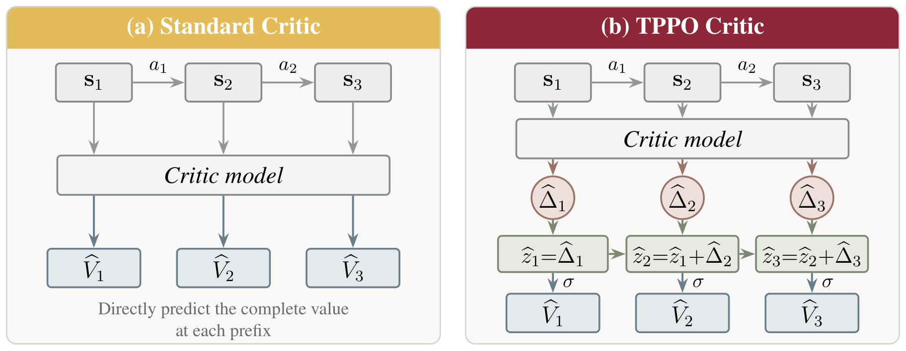

<div align="center">

<h1>TPPO: Tracking-Value PPO for Language Model Reasoning</h1>

<p><em>Tracking how prefix values evolve for better token-level credit assignment.</em></p>


<p>
  
</p>

</div>

---

## 📚 Contents

- [Introduction](#introduction)
- [Getting Started](#getting-started)
- [Usage](#usage)
- [Evaluation](#evaluation)
- [Results](#results)
- [Critic Analysis](#analysis)
- [Implementation](#implementation)

---

<a id="introduction"></a>

## 📖 Introduction

**TPPO (Tracking-Value PPO)** improves token-level credit assignment in PPO by modeling how values evolve along a reasoning trajectory. The critic accumulates updates in logit space to reconstruct the value of each response prefix. These values are trained with binary cross-entropy against the terminal reward and used in standard generalized advantage estimation (GAE) and PPO updates.

This repository provides the training, evaluation, and critic analysis code, built on **[slime v0.2.4](https://github.com/THUDM/slime/tree/v0.2.4)**.

<a id="method"></a>

### Method

For a response prefix $\mathbf{s}_t$, TPPO reconstructs its value as:

$$
\hat{z}_t = \sum_{i=1}^{t} f_\phi(\mathbf{s}_i),
\qquad \hat{V}_t = \sigma(\hat{z}_t).
$$

Here, $\mathbf{s}_i$ contains the prompt and preceding response tokens, $f_\phi$ is the scalar critic, and $\sigma$ is the sigmoid function. The first critic output provides the initial logit; subsequent outputs update it as the response unfolds. The reconstructed logits receive binary cross-entropy supervision from the terminal reward, and the resulting values are passed to GAE.

---

<a id="getting-started"></a>

## ✨ Getting Started

### Installation

Prepare the GPU environment using the [slime v0.2.4 installation guide](https://github.com/THUDM/slime/blob/v0.2.4/docs/en/get_started/quick_start.md), including Megatron-LM and SGLang. Then clone TPPO and install the modified framework:

```bash
git clone https://github.com/LINs-lab/TPPO.git
cd TPPO

python3 -m pip install --no-deps -e ./slime
python3 -m pip install math-verify

export MEGATRON_LM_PATH=/path/to/Megatron-LM
export PYTHONPATH="$PWD/slime:$MEGATRON_LM_PATH:${PYTHONPATH:-}"
```

Run the commands below from the repository root. Replace `/path/to/...` with your local model and checkpoint paths.

### Repository Structure

- [`scripts/`](scripts/): Training recipes for TPPO and the included baselines, organized by model and task.
- [`data/`](data/): Training, evaluation, and analysis datasets; see the [dataset guide](data/README.md) for file names and sample counts.
- [`eval/`](eval/): Evaluation on mathematics and out-of-domain reasoning benchmarks.
- [`analysis/manual_mc/`](analysis/manual_mc/): Critic evaluation against Monte Carlo estimates of prefix values.
- [`slime/`](slime/): The modified slime framework, including TPPO value reconstruction and critic training.

<a id="usage"></a>

## 🔧 Usage

### Data and Model Preparation

The training and evaluation datasets used by the scripts are included in [`data/`](data/). Polaris is used for mathematical reasoning training; Countdown has separate training and test splits.

Prepare both the **Hugging Face base model** and its **Megatron checkpoint** before training. Follow the [checkpoint conversion guide](slime/docs/en/get_started/quick_start.md#model-weight-conversion) for your model.

### Training

For example, train TPPO with Qwen3-8B-Base on Polaris:

```bash
HF_MODEL_PATH=/path/to/models/Qwen3-8B-Base \
MEGATRON_MODEL_PATH=/path/to/models/Qwen3-8B-Base-megatron \
bash scripts/8b_polaris/tppo.sh
```


Training recipes are available for the following models and tasks:

| Model / Task | Scripts |
| --- | --- |
| Llama-3.2-3B-Instruct / Polaris | [3b_llama](scripts/3b_llama/) |
| Qwen3-4B-Base / Polaris | [4b_polaris](scripts/4b_polaris/) |
| Qwen3-4B / Polaris | [4b_thinking_polaris](scripts/4b_thinking_polaris/) |
| Qwen3-8B-Base / Polaris | [8b_polaris](scripts/8b_polaris/) |
| Qwen2.5-Math-1.5B / Countdown | [countdown](scripts/countdown/) |

### Baselines

The [4B](scripts/4b_polaris/) and [8B](scripts/8b_polaris/) Polaris recipes include **PPO, GRPO, SPPO, and VAPO** alongside TPPO. Use the corresponding script with the same model paths, for example:

```bash
HF_MODEL_PATH=/path/to/models/Qwen3-8B-Base \
MEGATRON_MODEL_PATH=/path/to/models/Qwen3-8B-Base-megatron \
bash scripts/8b_polaris/ppo.sh
```

### Logs and Checkpoints

Logs and checkpoints are written under `outputs/` by default. Set `LOG_DIR` and `SAVE_DIR` to customize their locations. Training saves the best actor in `SAVE_DIR/best` and its matching critic in `SAVE_DIR/critic/best`; keep `ENABLE_EVAL=1` for best-checkpoint selection. The scripts configure W&B in offline mode.

<a id="evaluation"></a>

## 📃 Evaluation

Convert the trained Megatron actor checkpoint to Hugging Face format with [`convert_torch_dist_to_hf.py`](slime/tools/convert_torch_dist_to_hf.py). Then provide that checkpoint and the corresponding base Megatron checkpoint:

```bash
HF_CKPT_ROOT=/path/to/trained-hf-checkpoint \
BASE_MEGATRON_CKPT=/path/to/models/Qwen3-8B-Base-megatron \
EVAL_DATASETS=all GPU_COUNT=8 TP_SIZE=4 \
bash eval/eval.sh 8b_polaris
```

The model argument matches the training directory name. Set `TP_SIZE` to match the checkpoint's tensor parallelism.

| `EVAL_DATASETS` | Benchmarks |
| --- | --- |
| `math` | AIME24/25/26, AMC23, MATH500, MinervaMath, OlympiadBench |
| `ood` | ARC-C, AGI-Eval, BBH |
| `all` | Both groups |

To evaluate a single benchmark, set its identifier, such as `EVAL_DATASETS=aime24` or `EVAL_DATASETS=math500`. Run `bash eval/eval.sh --help` for the full list of options. Countdown task evaluation runs through its training scripts.

<a id="results"></a>

## 📈 Results

Results below use **Qwen3-8B-Base**. Scores are accuracies (%). Gains in parentheses are percentage-point improvements over PPO; bold values mark the best result on each benchmark.

### In-Domain Mathematics

| Method | AIME24/25/26 | AMC23 | MATH500 | Minerva | Olympiad | Avg. |
| --- | --- | ---: | ---: | ---: | ---: | ---: |
| Base | 8.2/6.8/6.4 | 33.8 | 54.3 | 24.9 | 27.2 | 23.1 |
| GRPO | 19.7/14.1/9.4 | 59.5 | 79.6 | 46.0 | 41.2 | 38.5 |
| PPO | 15.8/12.5/11.3 | 61.6 | 78.8 | 40.8 | 42.0 | 37.5 |
| VAPO | 14.2/13.3/8.3 | 59.4 | 79.6 | 47.4 | 40.8 | 37.6 |
| SPPO | 14.2/14.2/7.5 | 61.3 | 80.1 | 45.6 | 42.8 | 38.0 |
| **TPPO** | **25.8/22.3/20.5** | **67.3** | **85.4** | **49.8** | **50.2** | **45.9 (+8.4)** |

### Out-of-Domain Evaluation

| Method | ARC-C | AGI-Eval | BBH | OOD Avg. |
| --- | ---: | ---: | ---: | ---: |
| Base | 62.4 | 44.2 | 27.8 | 44.8 |
| GRPO | 93.0 | 67.7 | 34.8 | 65.2 |
| PPO | 92.2 | 68.4 | 42.2 | 67.6 |
| VAPO | 91.9 | 67.6 | 40.6 | 66.7 |
| SPPO | 92.9 | 69.9 | 40.7 | 67.8 |
| **TPPO** | **93.1** | **72.0** | **43.9** | **69.7** |

---

<a id="analysis"></a>

## 🔍 Critic Analysis

Compare TPPO and PPO critic predictions with Monte Carlo estimates of prefix values using matched actor and critic checkpoints:

```bash
ACTOR_CHECKPOINT=/path/to/actor/iter_0000119 \
CRITIC_CHECKPOINT=/path/to/critic/iter_0000119 \
ORIGIN_HF=/path/to/models/Qwen3-8B-Base \
TRAIN_TP=4 ACTOR_TP=2 MC_MODE=tppo \
bash analysis/manual_mc/run_manual_mc_example.sh
```

The example uses **two AIME24 questions**, **eight responses per question**, and **128 continuations per prefix**. Customize the run with:

- `MC_MODE=baseline` to analyze a PPO critic.
- `MC_LIMIT=0` to process the full dataset.
- `MC_DATASET` and `MC_OUTPUT_DIR` to select the input file and output directory.

For sampling across multiple GPUs and merging results, use [`run_mc_shards.py`](analysis/manual_mc/run_mc_shards.py).

<a id="implementation"></a>
<a id="code-changes"></a>

## 🧩 Implementation

The main TPPO changes to slime are in [`loss.py`](slime/slime/backends/megatron_utils/loss.py):

- **Value reconstruction:** `_values_from_response_logits` combines an initial logit with cumulative updates and applies a sigmoid.
- **Advantage estimation:** `get_values` and `compute_advantages_and_returns` pass the reconstructed values into GAE.
- **Critic training:** `value_loss_function` trains reconstructed logits with binary cross-entropy against terminal returns.

Critic configuration options, including TPPO mode and output-layer initialization, are defined in [`arguments.py`](slime/slime/utils/arguments.py). The [`tppo.sh`](scripts/8b_polaris/tppo.sh) recipes configure these options for each experiment.

<a id="acknowledgements"></a>

## 🌻 Acknowledgements

TPPO builds on [slime](https://github.com/THUDM/slime/tree/v0.2.4), [Megatron-LM](https://github.com/NVIDIA/Megatron-LM), [Megatron Bridge](https://github.com/NVIDIA-NeMo/Megatron-Bridge), and [SGLang](https://github.com/sgl-project/sglang), and uses [Math-Verify](https://github.com/huggingface/Math-Verify) for mathematical answer verification. We thank the maintainers and the open-source community for their models, datasets, and tools.

## License

Code is licensed under [Apache 2.0](LICENSE). Datasets retain their respective licenses; source information is listed in [data/README.md](data/README.md).
